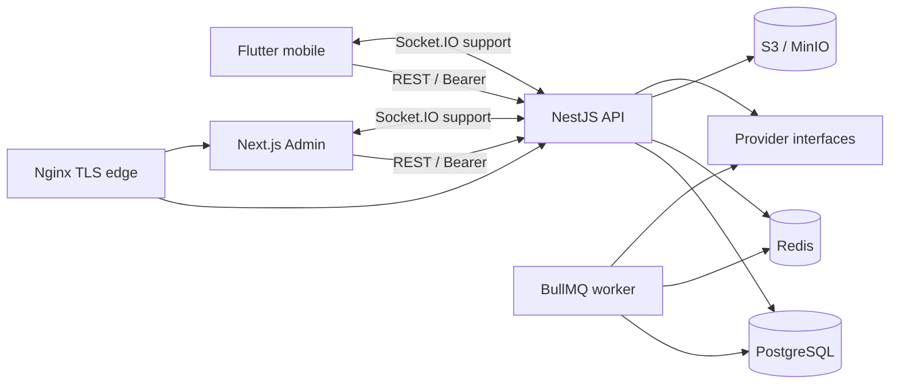

# Архитектура JANTOK

## Контекст и workspace

JANTOK v1 состоит из Flutter mobile, NestJS backend/worker и Next.js admin. Backend — единственный источник истины для цены, прав, календаря, статусов и операций. PostgreSQL хранит состояние, Redis обслуживает BullMQ/cache/locks, S3-compatible storage хранит файлы, Nginx выполняет staging TLS/WebSocket reverse proxy.



```text
jantok-mobile/   Flutter/Dart/Riverpod, Android-first и общая iOS codebase
jantok-backend/  NestJS/TypeScript/Prisma modular monolith и worker
jantok-admin/    Next.js/React/TypeScript
docs/            требования, решения и runbooks
infra/           Nginx/deployment assets
scripts/         воспроизводимые проверки и операции
```

Открывать в Android Studio: `jantok-mobile/`. У каждого приложения собственные manifest, lockfile и build; общий Git workspace сохраняет атомарность сквозных изменений.

## ADR-0001: модульный монолит

Статус: принято, 2026-09-22. API и worker используют общие доменные модули. Микросервисы/Kubernetes/event-streaming platform не вводятся. Надёжность строится на PostgreSQL constraints/transactions, idempotency/outbox и BullMQ.

## ADR-0002: физические соглашения

Статус: принято, 2026-09-22.

- PostgreSQL tables/columns — `snake_case`; Prisma models/fields — `PascalCase`/`camelCase` через `@@map`/`@map`.
- PK — UUID с DB default `gen_random_uuid()`; FK удаляются только явно, финансовая/операционная история позже будет append-only или soft-deleted по правилам домена.
- UTC instants — `timestamptz(3)`, service dates — `date`, business timezone — `Asia/Almaty`.
- Деньги в KZT — целые тенге; промежуточные доли, quantities и cost — PostgreSQL Decimal с явными units и округлением.
- Optimistic concurrency использует `version`; `updated_at` обновляется Prisma.
- Enum применяется к закрытым техническим состояниям; изменяемые бизнес-справочники хранятся таблицами, не enum.

## Миграции данных

Этап 0 охватывает identity/family ядро. Миграция Этапа 1 отдельно добавляет OTP, rotating sessions, household questionnaire/catalogs, recipe/allergen graph, versioned nutrition snapshots, meal selections, RBAC, audit и staff tasks. Ограничения E.164, halal-only, положительных величин, единственного default-адреса и append-only audit закреплены в PostgreSQL, а не только в API.

## ADR-0003: OTP и сессии

Статус: принято, 2026-09-22. OTP-код хранится в PostgreSQL только как HMAC; plaintext существует в адаптере доставки и для local/test кратковременно в Redis dev-inbox. Local adapter разрешает только allowlist синтетических телефонов, inbox требует отдельный токен, а production guard запрещает local mode. Access JWT короткоживущий, refresh — непрозрачный случайный токен с hash в БД. Каждая ротация архивирует использованный hash; повторное использование отзывает сессию и её push tokens. Устройства имеют независимые сессии.

## ADR-0004: безопасность питания

Статус: принято, 2026-09-22. Nutrition Engine выбирает только версионированный rule set (`DEMO` локально, исключительно `APPROVED` в production), сохраняет входной snapshot и возрастную группу на service date. Коэффициенты являются данными, а не скрытыми константами. Safety check выполняется backend перед записью выбора и объединяет прямые риски блюда, ингредиенты после допустимых удалений, добавленные ингредиенты, add-ons, diet tags, verified и global halal. Неклассифицированная аллергия блокирует автоматический выбор и создаёт staff task.

## ADR-0005: RBAC

Статус: принято, 2026-09-22. Права вычисляются backend по `employee → roles → permissions`; admin UI не является границей доверия. Два production Super Admin создаются идемпотентно только из env, локальные демонстрационные сотрудники используют отдельную переменную.

## ADR-0006: cut-off и оплаченные обязательства

Статус: принято, 2026-09-22. Все menu/payment/skip/pause/address/add-on/kitchen решения проходят через единый `CutoffService` в `Asia/Almaty`; операция допустима только при `now < deadline`. Политики версионируются и неизменяемы на уровне PostgreSQL. Подписка ссылается на конкретную политику и дополнительно хранит snapshot, поэтому новая версия не меняет оплаченный цикл. Время локального подтверждения платежа одновременно является authoritative payment time; production checkout заблокирован до подключения реального provider adapter.

## ADR-0007: pricing, покупки и service-day ledger

Статус: принято, 2026-09-22. Business pricing выбирает только `DEMO` в local/test и только `ACTIVE` в production. Quote хранит входы, строки и итог `participants + extras - discounts - bonus = cash`; принятые quote/lines и payment attempts неизменяемы DB triggers. Purchase, payment attempt, subscription и daily order — разные сущности. 30 оплаченных дней представлены явными allocations и append-only событиями `PLAN/RESERVE/USE/TRANSFER/CANCEL/COMPENSATE`; skip/pause сохраняют исходный день и добавляют перенос в конец.

## ADR-0008: опубликованное меню и snapshots

Статус: принято, 2026-09-22. Выбрать можно только вариант опубликованной даты и meal slot. Safety gate применяется после допустимых удалений, allowlisted additions со stock и add-ons. В выборе сохраняются recipe/nutrition/price/safety snapshots; строки daily order имеют отдельные immutable recipe/modification/nutrition/price snapshots для будущей production-фиксации.

## ADR-0009: payment boundary и авторитетное подтверждение

Статус: принято, 2026-09-24. `PaymentProvider` принимает только internal IDs, сумму, idempotency key и opaque saved-method token; PAN/CVV отсутствуют в API и schema. Purchase/payment attempt/outbox сохраняются до внешнего вызова. Только синхронный авторитетный ответ, проверенный webhook или reconciliation переводит attempt в `CAPTURED` и идемпотентно активирует/продлевает подписку. Browser/deep-link return никогда не является подтверждением. Уникальные provider operation/event IDs и provider event time защищают от повторов и перестановки событий.

## ADR-0010: refund, bonus ledger и receipt lifecycle

Статус: принято, 2026-09-24. Refund резервирует отдельно cash и bonus в транзакции, не превышая captured/unrefunded остаток. Cash возвращается тем же provider operation, bonus — append-only ledger credit/reversal; история не удаляется. Обычный refund следует версионированному окну и отменяет будущие обязательства, административная компенсация имеет отдельный RBAC/audit path. Receipt/fiscal document живёт независимо: его ошибка не повторяет оплату. Local receipt всегда `fiscal=false` и явно тестовый.

## ADR-0011: renewal от конца service days

Статус: принято, 2026-09-24. Renewal job уникален по subscription/cycle-end и хранит frozen price/terms, mandate, notice/charge instants и ограниченный retry budget. Pause/skip переносит cycle-end и оба job instant; прежнее notice инвалидируется. Worker не списывает без активного mandate и полного окна уведомления. Renewal provider call использует стабильный idempotency key; транзакционное завершение добавляет ровно 30 service days и создаёт следующий job.

## ADR-0012: loyalty ledger, reservations и qualification

Статус: принято, 2026-09-24. Bonus ledger неизменяем: credit/debit/reserve/release/refund/compensation/reversal никогда не редактируются задним числом. Quote резервирует bonus и promo под household advisory lock; purchase activation атомарно подтверждает reservation и применяет welcome/referral/CLUB effects с уникальными idempotency keys. Referral и CLUB зависят от authoritative successful purchase, а refund создаёт пропорциональное сторно и пересчитывает qualifying paid cycles. Уровни и правила являются versioned business data, local примеры помечены `DEMO`.

## ADR-0013: household fulfillment и внешний delivery boundary

Статус: принято, 2026-09-24. `daily_fulfillments` агрегирует member/guest/add-on за день household и отделяет физический статус от финансового. `READY` планирует persisted delivery job, но provider вызывается только в `dispatch_at`. Один fulfillment допускает одну активную попытку; timeout/restart использует тот же idempotency key и reconciliation. Неизвестные/запоздавшие provider states не регрессируют terminal state.

## ADR-0014: revisioned production и двойная складская запись

Статус: принято, 2026-09-24. Kitchen получает immutable `FORECAST/FINAL/DELTA` revisions. Variant key включает recipe/modification/portion/restrictions; FINAL резервирует, а production confirmation атомарно создаёт фактические inventory movements и освобождает резервы. `on_hand`, `reserved`, immutable movement ledger и weighted-average valuation являются источником воспроизводимой себестоимости. Packing и print документы ссылаются на revision snapshots, поэтому поздняя правка каталога не переписывает исполнение.

## ADR-0015: persisted support и realtime как доставка события

Статус: принято, 2026-09-24. Support message сначала сохраняется в PostgreSQL с unique `(thread_id, client_message_id)`, затем Socket.IO публикует `message:created`. Room join повторно проверяет ownership/RBAC. Reconnect восстанавливает history через REST, поэтому WebSocket не является источником истины.

## ADR-0016: versioned System Settings, analytics и Admin

Статус: принято, 2026-09-24. Admin читает/изменяет только backend resources. Permissions проверяются на API; UI лишь скрывает недоступное. System Settings хранит versioned `DEMO/DRAFT/APPROVED/RETIRED` business values и отклоняет secrets. Analytics строится из persisted domain rows; export фиксирует filters/timezone/units/currency, permission scope, owner и expiration.

## ADR-0017: environment separation и fail-closed providers

Статус: принято, 2026-09-25. LOCAL/STAGING/PRODUCTION имеют разные secrets/DB/Redis/buckets. Local adapters никогда не являются fallback: production validation запрещает `local`, demo seed и известные local secrets. `unconfigured` явно отказывает во внешней операции. Provider-specific sandbox/production mode добавляется только с official adapter/contract tests.

## ADR-0018: evidence-based readiness

Статус: принято, 2026-09-27. Требование может иметь `LOCAL_VERIFIED` только с указанным implementation path и воспроизводимой проверкой. Отсутствующие provider contracts, hosted CI, device/iOS tooling и owner-approved business values помечаются `BLOCKED_EXTERNAL`/`PENDING_EXTERNAL`, а не «готово». Machine evidence T01–T42 хранится в `output/stage10/`, а owner inputs — в `docs/CLIENT_DATA_REQUEST.md`.

## Связанные документы

- физическая схема и ERD: `docs/DATABASE.md`;
- REST/realtime/jobs/states: `docs/API.md`;
- provider boundaries: `docs/INTEGRATIONS.md`;
- deployment/rollback: `docs/DEPLOYMENT.md`.
