# База данных JANTOK

## Фактическое состояние

Источник истины — `jantok-backend/prisma/schema.prisma`: **111 моделей**, **59 enum**, PostgreSQL 17 и **15 последовательных миграций**. Prisma-модели используют `PascalCase`/`camelCase`, физические таблицы и столбцы — `snake_case` через `@@map`/`@map`.

Проверка схемы:

```bash
cd jantok-backend
npm run prisma:validate
npm run db:migrate:deploy
npx prisma migrate status
```

Все даты-времена хранятся как UTC instants (`timestamptz(3)`), service dates — как `date`; бизнес-часовой пояс — `Asia/Almaty`. Деньги KZT — целые тенге. Количества и себестоимость используют Decimal и явную единицу.

## Логическая ERD

Диаграмма показывает главные агрегаты и связи. Ассоциативные таблицы, переводы, snapshots и технические индексы сокращены; полный физический граф задаётся Prisma schema и миграциями.

```mermaid
erDiagram
  User ||--o{ UserSession : sessions
  User ||--|| Household : owns
  User ||--o| Employee : staff_identity
  User ||--o{ DeviceToken : push_devices

  Household ||--o{ HouseholdMember : contains
  Household ||--o{ HouseholdAddress : saves
  Household ||--o{ PriceQuote : requests
  Household ||--o{ Purchase : pays
  Household ||--o{ Subscription : subscribes

  HouseholdMember ||--|| MemberProfile : profile
  HouseholdMember ||--o{ MemberAllergy : allergies
  HouseholdMember ||--o{ NutritionRecommendation : recommendations
  HouseholdMember ||--o{ MemberMealSelection : selections

  Meal ||--o{ MealIngredient : recipe
  Ingredient ||--o{ MealIngredient : used_in
  Ingredient ||--o{ IngredientAllergen : risks
  Meal ||--o{ PublishedMenuOption : published_as
  MenuPublication ||--o{ PublishedMenuOption : contains

  PriceQuote ||--o{ PriceQuoteLine : itemizes
  PriceQuote ||--o| Purchase : accepted_as
  Purchase ||--o{ PaymentAttempt : attempts
  Purchase ||--o{ Refund : refunds
  Purchase ||--o{ Receipt : fiscal_documents
  Purchase ||--o| Subscription : activates

  Subscription ||--o{ SubscriptionParticipant : participants
  Subscription ||--o{ SubscriptionServiceDay : allocates
  Subscription ||--o{ SubscriptionPause : pauses
  Subscription ||--o{ RenewalJob : renewals
  SubscriptionServiceDay ||--o{ ServiceDayEvent : ledger
  SubscriptionServiceDay ||--o{ DailyOrder : member_orders
  SubscriptionServiceDay ||--o| DailyFulfillment : household_fulfillment

  DailyOrder ||--o{ DailyOrderLine : lines
  DailyFulfillment ||--o{ DailyFulfillmentEvent : state_history
  DailyFulfillment ||--o{ DeliveryAttempt : delivery_attempts
  DeliveryAttempt ||--o{ DeliveryProviderEvent : provider_events
  DailyFulfillment ||--o{ DeliveryJob : dispatch_jobs

  Household ||--o{ BonusLedgerEntry : bonus_ledger
  Household ||--o{ BonusReservation : bonus_holds
  PromoCode ||--o{ PromoReservation : usage_holds
  User ||--o{ Referral : referrals
  Household ||--o| ClubMembership : club

  ProductionRevision ||--o{ ProductionLine : lines
  ProductionLine ||--o{ ProductionIngredientNeed : ingredients
  ProductionRevision ||--o{ ProductionRun : facts
  Ingredient ||--o{ InventoryBalance : balances
  Ingredient ||--o{ InventoryMovement : movements
  Supplier ||--o{ SupplierPurchase : purchases
  SupplierPurchase ||--o{ SupplierPurchaseItem : items
  DailyFulfillment ||--o{ PackingTask : packing
  PackingTask ||--o{ PackingItem : items
  ProductionRevision ||--o{ PrintDocument : documents

  Employee ||--o{ EmployeeRole : roles
  Role ||--o{ EmployeeRole : employees
  Role ||--o{ RolePermission : permissions
  Permission ||--o{ RolePermission : roles
  Employee ||--o{ AuditLog : actions

  Household ||--o{ SupportThread : support
  SupportThread ||--o{ SupportMessage : messages
  DailyOrderLine ||--o{ MealReview : reviews
  User ||--o{ NotificationOutbox : notifications
  Employee ||--o{ ExportJob : exports
```



## Модели по контурам

### Identity, sessions и household

`User`, `OtpChallenge`, `UserSession`, `UsedRefreshToken`, `DeviceToken`, `Household`, `HouseholdAddress`, `HouseholdMember`, `MemberProfile`.

OTP хранится только как HMAC. Refresh token хранится как hash; повтор использованного refresh отзывает конкретную сессию. Household ownership является частью запросов backend, а не только UI-фильтром.

### Анкета, питание, меню и безопасность

`ActivityLevel`, `SportType`, `MemberSport`, `DietType`, `IngredientTag`, `DietTypeExcludedTag`, `Allergen`, `MemberAllergy`, `Ingredient`, `IngredientAllergen`, `IngredientTagLink`, `MemberFoodPreference`, `Meal`, `MealTranslation`, `MealIngredient`, `MealAllergenRisk`, `Addon`, `AddonCategory`, `AddonIngredient`, `NutritionRuleSet`, `NutritionCoefficient`, `NutritionRecommendation`, `MemberMealSelection`, `MenuPublication`, `PublishedMenuOption`, `MealAllowedAddition`.

Версии правил, рецептов, nutrition и safety сохраняются в snapshots оплаченного/исполняемого заказа. Изменение каталога не переписывает историю.

### RBAC, audit и настройки

`Employee`, `Role`, `Permission`, `EmployeeRole`, `RolePermission`, `AuditLog`, `StaffTask`, `SystemSetting`, `CutoffPolicy`, `PricingRuleSet`, `PaymentSettings`, `DeliverySettings`, `DeliveryZone`, `DeliverySlot`, `LoyaltySettings`.

`audit_logs` append-only: UPDATE/DELETE запрещены DB trigger. Настройки версионируются; секретоподобные значения в `system_settings` запрещены.

### Quote, purchase, subscription и исполнение

`PriceQuote`, `PriceQuoteLine`, `Purchase`, `Subscription`, `SubscriptionGuest`, `SubscriptionParticipant`, `SubscriptionServiceDay`, `ServiceDayEvent`, `SubscriptionPause`, `DailyOrder`, `DailyOrderLine`, `SubscriptionChangeQuote`, `SubscriptionCharge`, `StandaloneAddonOrder`, `ServiceDayAddressOverride`.

Quote после принятия неизменяем. Service days представлены отдельными allocations и событиями; pause/skip переносит обязательство, не сокращая оплаченные 30 дней.

### Payments, refunds, receipts и loyalty

`PaymentAttempt`, `PaymentMethod`, `ProviderWebhookEvent`, `Refund`, `Receipt`, `PaymentOutbox`, `RenewalJob`, `BonusLedgerEntry`, `BonusReservation`, `PromoCode`, `PromoReservation`, `ReferralTier`, `Referral`, `ClubTier`, `ClubMembership`, `RecurringAddonPlan`, `RecurringAddonAllocation`, `RecurringAddonRefund`.

PAN/CVV моделей нет. Сохраняются opaque provider token/mandate и маскированные metadata. Денежные, bonus и promo операции имеют idempotency/unique constraints; возвраты и сторно добавляют записи, а не удаляют историю.

### Delivery и Daily Fulfillment

`DailyFulfillment`, `DailyFulfillmentEvent`, `DeliveryAttempt`, `DeliveryProviderEvent`, `DeliveryJob` плюс versioned delivery settings/zone/slots и immutable address snapshot.

Физическое и финансовое состояние разделены. Частичный уникальный индекс допускает не более одной активной delivery attempt на fulfillment.

### Support, reviews, notifications и analytics

`MealReview`, `ReviewModeration`, `SupportThread`, `SupportMessage`, `NotificationPreference`, `NotificationTemplate`, `NotificationOutbox`, `ExportJob`.

Support message дедуплицируется `(thread_id, client_message_id)`. Export принадлежит сотруднику, имеет permission scope и срок жизни. CSV/XLSX защищены от formula injection.

### Kitchen, inventory, закупки и печать

`StorageLocation`, `InventoryBalance`, `InventoryMovement`, `Supplier`, `SupplierPurchase`, `SupplierPurchaseItem`, `WasteEntry`, `ProductionRevision`, `ProductionLine`, `ProductionIngredientNeed`, `InventoryReservation`, `ProductionRun`, `PackingTask`, `PackingItem`, `PrintDocument`.

`on_hand` и `reserved` разделены. Forecast не двигает склад; подтверждённое производство создаёт фактическое движение один раз. Weighted-average cost фиксируется на расходе. Waste имеет одну business-запись и одно связанное движение.

## Неизменяемость и конкурентность

- UUID генерируются PostgreSQL через `gen_random_uuid()`.
- Версии строк используются для optimistic concurrency в редактируемых operational aggregates.
- Advisory locks сериализуют checkout household/promo и конкурентные складские операции.
- Уникальные idempotency keys защищают платежи, refunds, outbox, jobs, события, печать и производство.
- Финансовые ledgers, audit, service-day events и stock movements не исправляются удалением; используется compensating entry.
- DB constraints запрещают отрицательные деньги/количества, неправильный E.164, несколько default address и резерв выше остатка.

## Миграции

| Миграция | Содержание |
| --- | --- |
| `20260922000100_foundation` | users, sessions/devices, household/member/profile foundation |
| `20260922022000_stage1_auth_household_nutrition` | OTP, questionnaire/catalogs, nutrition, RBAC/audit |
| `20260922030000_stage1_questionnaire_integrity` | questionnaire integrity constraints |
| `20260922123825_stage2_menu_subscription_pricing` | menu, pricing, purchase, subscription/service days/orders |
| `20260922131000_stage2_immutability` | immutable snapshots/triggers |
| `20260922132500_stage2_subscription_changes` | pause/skip/member/guest change lifecycle |
| `20260922134500_stage2_meal_reviews` | reviews |
| `20260922141000_stage2_standalone_addons` | one-off add-ons |
| `20260924120000_stage3_payments_refunds_renewals` | payments, refunds, receipts, outbox, renewals |
| `20260924160000_stage4_loyalty_addons_referral_club` | bonus/promo/referral/CLUB/recurring add-ons |
| `20260924163000_stage4_recurring_addon_checkout` | recurring add-on checkout |
| `20260924170000_stage4_recurring_addon_refunds` | recurring add-on refunds |
| `20260924190000_stage5_delivery_fulfillment` | zone/slots/fulfillment/delivery jobs/events |
| `20260924210000_stage6_kitchen_inventory` | production/packing/inventory/suppliers/print |
| `20260924230000_stage7_admin_rbac_support_analytics` | expanded RBAC, support, notifications, settings, exports |

Миграции forward-only. Rollback приложения выполняется совместимым предыдущим image; несовместимый data rollback — только через проверенный backup в отдельную DB/bucket по `docs/DEPLOYMENT.md`.
